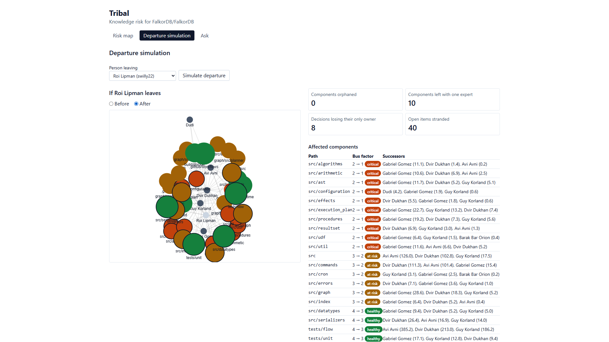
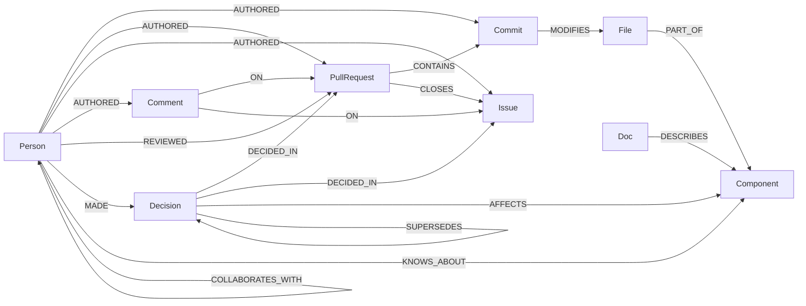

# Tribal

Tribal is an open-source knowledge-risk engine for engineering teams. It reads a GitHub repository, builds a knowledge graph in [FalkorDB](https://www.falkordb.com/), and shows who knows what, what breaks if someone leaves, and why decisions were made.

Built for Graph Hacks (WeMakeDevs x FalkorDB), **Company Brain** track. The demo treats the public [FalkorDB/FalkorDB](https://github.com/FalkorDB/FalkorDB) repository as "the company": its maintainers are the people, its folders are the components, its pull requests and issues are the tickets and chats, and its markdown files are the docs.



## Live demo

- Web app: https://tribal.ssaarthakk.me
- Backend health: https://tribal-backend-gaxe.onrender.com/api/health
- Demo video: https://youtu.be/XUG6PpnAPeQ

## How it works

1. `fetch` reads commits, pull requests, reviews, issues, comments and markdown docs from one GitHub repo into `data/snapshot.json`. It is the only command that talks to GitHub.
2. `extract-decisions` asks an LLM to pull decisions out of PR and issue threads and caches them in `data/decisions.json`.
3. `load` rebuilds the FalkorDB graph from those files, merges each person's login, emails and name variants into one `Person`, and computes expertise, bus factor and collaboration in Cypher.
4. The Hono API, the chat agent and the MCP server all read the graph through the same Cypher queries and FalkorDB algorithms. TypeScript only reshapes the rows.
5. The web app has three screens: **Risk map** (people and components coloured by bus factor), **Departure simulation** (pick a person, see what breaks, get a handover plan) and **Ask** (chat with answers that cite GitHub links and show the graph path they used).

## Graph data model



| Node          | Meaning                                                                               |
| ------------- | ------------------------------------------------------------------------------------- |
| `Person`      | A contributor: GitHub login, or `git:<emailHash>` for a commit author with no account |
| `Component`   | A folder of the codebase, such as `src/commands`, with its bus factor                 |
| `File`        | A file path, part of one component                                                    |
| `Commit`      | A commit with its first message line, date and URL                                    |
| `PullRequest` | A pull request with title, body, state and dates                                      |
| `Issue`       | An issue with title, body, state and dates                                            |
| `Comment`     | A conversation or review comment on a pull request or issue                           |
| `Doc`         | A markdown file at the head of the default branch                                     |
| `Decision`    | A decision extracted from a PR or issue thread, with rationale and status             |

| Relationship        | From → To                                    | Meaning                                                                       |
| ------------------- | -------------------------------------------- | ----------------------------------------------------------------------------- |
| `AUTHORED`          | Person → Commit, PullRequest, Issue, Comment | Who wrote it                                                                  |
| `REVIEWED`          | Person → PullRequest                         | The reviewer's latest review (`state`, `at`)                                  |
| `MODIFIES`          | Commit → File                                | Lines changed (`additions`, `deletions`)                                      |
| `PART_OF`           | File → Component                             | Which component a file belongs to                                             |
| `CONTAINS`          | PullRequest → Commit                         | The PR's merge (squash) commit                                                |
| `CLOSES`            | PullRequest → Issue                          | The PR closes the issue                                                       |
| `ON`                | Comment → PullRequest or Issue               | Where the comment was posted                                                  |
| `DESCRIBES`         | Doc → Component                              | The doc is about the component                                                |
| `MADE`              | Person → Decision                            | Who took part in the decision                                                 |
| `DECIDED_IN`        | Decision → PullRequest or Issue              | The thread the decision came from                                             |
| `AFFECTS`           | Decision → Component                         | Which components the decision affects                                         |
| `SUPERSEDES`        | Decision → Decision                          | A newer decision replaces an older one                                        |
| `KNOWS_ABOUT`       | Person → Component                           | Derived expertise: `score`, `share`, `last_active`, `expert`                  |
| `COLLABORATES_WITH` | Person → Person                              | Derived collaboration `weight`, stored in both directions with the same value |

## Cypher queries and graph algorithms

Every query lives in [`backend/src/queries.ts`](backend/src/queries.ts) as a named constant. Feature IDs: F1 GitHub ingestion, F2 graph model and identity merging, F3 expertise scores, F4 knowledge risk (a bus factor, b team ranking, c departure simulation), F5 decision tracking, F6 agent Q&A with sources, F7 handover plan, F8 MCP server, F9 web UI.

### Setup and health

- `PING`: returns 1 to check the connection (database tests). F2.
- `COUNT_NODES`: counts all nodes for `/api/health`, the load summary and the server's auto-seed check. F2, F9.
- `COUNT_LABELS`: counts nodes per label for the load summary. F2.
- `COUNT_RELATIONSHIPS`: counts relationships per type for the load summary. F2.
- `CREATE_INDEXES`: creates the range indexes on every node key before loading. F2.
- `CREATE_FULLTEXT_INDEXES`: creates the full-text indexes on PR, issue, decision and doc text. F2, F6.

### Loading

- `MERGE_PEOPLE`: inserts merged people with login and name. F2.
- `MERGE_COMPONENTS`: inserts components with a starting bus factor of 0. F2.
- `MERGE_FILES`: inserts files and links each to its component with `PART_OF`. F1, F2.
- `MERGE_COMMITS`: inserts commits and links their author with `AUTHORED`. F1, F2.
- `MERGE_MODIFIES`: links commits to the files they change, with line counts. F1, F2.
- `MERGE_PULL_REQUESTS`: inserts pull requests and links their author. F1, F2.
- `MERGE_CONTAINS`: links each PR to its merge commit. F2.
- `MERGE_REVIEWS`: adds one `REVIEWED` edge per reviewer and PR with the latest review state. F2.
- `MERGE_ISSUES`: inserts issues and links their author. F1, F2.
- `MERGE_CLOSES`: links PRs to the issues they close. F2.
- `MERGE_PR_COMMENTS`: inserts PR comments, links them to their PR and author. F1, F2.
- `MERGE_ISSUE_COMMENTS`: inserts issue comments, links them to their issue and author. F1, F2.
- `MERGE_DOCS`: inserts markdown docs and links them to the components they describe. F1, F2.
- `MERGE_DECISIONS_IN_PULL_REQUESTS`: inserts decisions taken in PRs and links them with `DECIDED_IN`. F5.
- `MERGE_DECISIONS_IN_ISSUES`: inserts decisions taken in issues and links them with `DECIDED_IN`. F5.
- `MERGE_MADE`: links decisions to the people who made them. F5.
- `MERGE_AFFECTS`: links decisions to the components they affect. F5.
- `MERGE_SUPERSEDES`: links a newer decision to the older one it replaces. F5.
- `SET_DECISION_STATUS`: marks a decision `superseded` if any decision supersedes it, else `active`. F5.

### Expertise, bus factor and collaboration

- `DELETE_KNOWS_ABOUT`: removes old expertise edges before recomputing. F3.
- `ADD_COMMIT_EXPERTISE`: adds commit activity, `log2(1 + lines)` with time decay, to `KNOWS_ABOUT`. F3.
- `ADD_AUTHORED_PR_EXPERTISE`: adds authored-PR activity with time decay for each component the PR touches. F3.
- `ADD_REVIEW_EXPERTISE`: adds review activity with time decay for each component the reviewed PR touches. F3.
- `ADD_PR_COMMENT_EXPERTISE`: adds PR comment activity with time decay. F3.
- `ADD_ISSUE_COMMENT_EXPERTISE`: adds comment activity on issues closed by a PR that touches the component. F3.
- `MARK_EXPERTS`: sets each person's `share` of a component and whether they are an active expert. F3, F4a.
- `SET_BUS_FACTOR`: sets each component's bus factor to its number of experts. F4a.
- `DELETE_COLLABORATION`: removes old collaboration edges before recomputing. F4b.
- `ADD_REVIEW_COLLABORATION`: adds collaboration weight for each PR one person reviewed for another. F4b.
- `ADD_SHARED_EXPERTISE_COLLABORATION`: adds collaboration weight for each component two people are both experts in. F4b.

### Read models

- `LIST_COMPONENTS`: lists components by bus factor, riskiest first (`bus_factor` tool, Risk map table). F4a, F6, F8, F9.
- `RISK_MAP_LINKS`: lists person-to-component expertise links above a minimum share for the Risk map graph. F4a, F9.
- `GET_COMPONENT`: reads one component and its bus factor. F6, F9.
- `COMPONENT_EXPERTS`: lists the people who know a component best (component panel, `who_knows`). F3, F6, F9.
- `COMPONENT_DECISIONS`: lists the decisions affecting a component with who made them and what they supersede (`decision_history`). F5, F6, F9.
- `COMPONENT_DOCS`: lists the docs that describe a component. F6, F9.
- `COMPONENT_RECENT_PULL_REQUESTS`: lists the latest PRs that touched a component. F6, F9.
- `GET_PERSON`: reads one person by id. F4c, F6.
- `PERSON_COMPONENTS`: lists the components a person knows, with score and expert flag. F6.
- `PERSON_DECISIONS`: lists the decisions a person took part in. F5, F6.
- `OPEN_WORK`: lists a person's open PRs and issues. F4c, F6, F7.
- `TEAM_PAGERANK`: runs PageRank on the collaboration graph. F4b.
- `TEAM_BETWEENNESS`: runs betweenness centrality on the collaboration graph. F4b.
- `NEARBY_COLLABORATORS`: finds people within two collaboration hops of a person, ordered by direct weight. F4c, F7.
- `DEPARTURE_COMPONENTS`: for a leaving person, lists the components they are an expert in and the bus factor before and after. F4c, F7.
- `DEPARTURE_SUCCESSORS`: lists the top 3 other people by expertise for each affected component. F4c, F7.
- `DEPARTURE_DECISIONS`: lists active decisions where the leaving person is the only owner. F4c, F5, F7.

### Search

- `SEARCH_ALL`: full-text search over PRs, issues, decisions and docs, top 5 of each (`search` tool). F6, F8.
- `TOPIC_COMPONENTS`: maps full-text hits to the components they touch, the first step of `who_knows`. F6, F8.

### FalkorDB procedures

- `algo.pageRank('Person', 'COLLABORATES_WITH')`: finds the people the collaboration network depends on most. Used in the team ranking and to pick the demo people for cached handover plans. F4b, F7.
- `algo.betweenness({nodeLabels: ['Person'], relationshipTypes: ['COLLABORATES_WITH'], samplingSize: 1000, samplingSeed: 42})`: finds the people who bridge otherwise separate groups, so losing them splits the team. The fixed seed keeps it reproducible. F4b.
- `db.idx.fulltext.createNodeIndex`: makes the text searchable by `db.idx.fulltext.queryNodes`. F2, F6.
- `db.idx.fulltext.queryNodes`: ranked keyword search over that text, so the agent and `who_knows` can go from a question to the PRs, decisions and docs behind it and then follow graph edges to components and people. F6.

## Scoring and risk definitions

- **Activity** per person and component, each multiplied by a time decay with a 180-day half-life: commit `1.0 × log2(1 + lines changed)`, authored PR `0.8`, review `0.6`, comment `0.2`. "Now" is the snapshot's fetch time, so results are reproducible.
- **Score** is the sum of activities; **share** is the score divided by the component's total.
- **Expert**: share of at least 10% and active in the last 365 days.
- **Bus factor** is the number of experts. Risk level: `0` orphaned, `1` critical, `2` at risk, `3+` healthy.
- **Collaboration weight** between two people: PRs where one reviewed the other's, plus 0.5 for each component where both are experts.
- **Departure simulation** (read-only, nothing is deleted): affected components are those where the person is an expert, and the bus factor after is the number of other experts.
- **Team ranking**: PageRank and betweenness over people and `COLLABORATES_WITH`, sorted by PageRank.

## Local setup

Requires Node.js 24 (see `.nvmrc`) and Bash (on Windows, run the commands from Git Bash).

1. Install and create your `.env`:

   ```bash
   npm install
   cp .env.example .env
   ```

2. Get a FalkorDB instance. Either create a free instance on [FalkorDB Cloud](https://app.falkordb.cloud/) and put its host, port, username and password in `.env`, or run one locally with `docker run -p 6379:6379 falkordb/falkordb` and set `FALKORDB_HOST=localhost`.
3. Optional: put a [Google AI Studio](https://aistudio.google.com/) key in `LLM_API_KEY` for the Ask screen and fresh handover plans. Without it, everything else works and handover plans come from the cache or a template.
4. Load a graph. The demo data is committed in `data/`, so no GitHub access is needed:

   ```bash
   npm --workspace backend run cli -- load
   ```

   Use `load --fixture` instead for the small synthetic test fixture. The server also loads the demo data by itself when it starts on an empty graph.

5. Start the backend and the web app in two terminals, then open http://localhost:5173:

   ```bash
   npm --workspace backend run dev
   npm --workspace web run dev
   ```

`bash scripts/doctor.sh` shows which variables and tools are set up, without printing any values.

## Pointing it at another repo

1. Edit `data/config.json`: set `repo` (`owner/name`) and `since` (the first date to fetch).
2. Fetch from GitHub. It uses `GITHUB_TOKEN` from `.env`, or `gh auth token` if that is empty:

   ```bash
   npm --workspace backend run cli -- fetch
   ```

3. Extract decisions (needs `LLM_API_KEY`; results are cached, so a rerun continues where it stopped):

   ```bash
   npm --workspace backend run cli -- extract-decisions
   ```

4. Rebuild the graph:

   ```bash
   npm --workspace backend run cli -- load
   ```

## MCP server

Tribal exposes its eight tools (`search`, `who_knows`, `bus_factor`, `get_component`, `get_person`, `simulate_departure`, `team_ranking`, `decision_history`) over MCP on stdio. Build the backend first:

```bash
npm --workspace backend run build
```

Then add this to Claude Desktop (`claude_desktop_config.json`) or Cursor (`.cursor/mcp.json`), with your own absolute paths:

```json
{
  "mcpServers": {
    "tribal": {
      "command": "node",
      "args": [
        "--env-file=/absolute/path/to/tribal/.env",
        "/absolute/path/to/tribal/backend/dist/cli.js",
        "mcp"
      ]
    }
  }
}
```

In Claude Code: `claude mcp add tribal -- node --env-file=/absolute/path/to/tribal/.env /absolute/path/to/tribal/backend/dist/cli.js mcp`.

For ad-hoc Cypher against the same graph, run FalkorDB's official MCP server alongside it with `bash scripts/falkordb-mcp.sh`.

## Architecture

```
GitHub REST API ──────────────fetch──▶ data/snapshot.json ──load──▶ FalkorDB graph ◀── queries.ts
                                             │                          ▲
Gemini (OpenAI-compatible) ◀─extract-decisions─┘ data/decisions.json ──┘
                                                                        │
                    Hono API (app.ts) ◀── tools.ts ──▶ MCP server (mcp.ts)
                          ▲                 ▲
                  web (Vite + React)     agent.ts (chat, tool calling)
```

An npm workspace with `backend` (Hono, TypeScript) and `web` (Vite, React, Tailwind). Backend modules in `backend/src/`:

- `env.ts`: parses and validates environment variables.
- `db.ts`: connects to FalkorDB and runs queries with validated rows.
- `queries.ts`: every Cypher query.
- `datafiles.ts`: schemas and read/write functions for the files in `data/`.
- `components.ts`: maps a file path to its component.
- `identity.ts`: merges GitHub logins, commit emails and names into people.
- `github.ts`: GitHub REST calls (the only module that talks to GitHub).
- `ingest.ts`: turns GitHub responses into a snapshot.
- `load.ts`: rebuilds the graph from a snapshot and the decision cache.
- `expertise.ts`: computes expertise, experts, bus factor and collaboration in the graph.
- `schemas.ts`: types shared by the API, tools and agent.
- `risk.ts`: risk map, components, people, ranking, departure simulation and decision history.
- `search.ts`: full-text search and "who knows about X".
- `llm.ts`: the only module that calls the LLM.
- `decisions.ts`: extracts decisions from threads and maintains the cache.
- `handover.ts`: builds, narrates, renders and caches handover plans.
- `tools.ts`: the tool list shared by the chat agent and the MCP server.
- `agent.ts`: the tool-calling chat agent, which may only state facts from tool results.
- `app.ts`: the HTTP API routes.
- `server.ts`: starts the HTTP server and seeds an empty graph.
- `mcp.ts`: the MCP stdio server.
- `cli.ts`: the command line (`serve`, `fetch`, `load`, `extract-decisions`, `handovers`, `mcp`).

The full design is in [`docs/ARCHITECTURE.md`](docs/ARCHITECTURE.md).

## Tests

```bash
npm run check
```

`check` runs Prettier, ESLint, the TypeScript build, Vitest and the web build, and stops at the first failure. Tests load the synthetic fixture in `data/fixture/` into a throwaway graph and never call GitHub or a live LLM.

## Built with AI assistance

This project was built with the help of [Claude Code](https://claude.com/claude-code), an AI coding assistant, as allowed by the hackathon rules. The graph model, queries and architecture are documented in this README and in `docs/ARCHITECTURE.md`, and the author can explain each of them.

## License

MIT. See [`LICENSE`](LICENSE).

## Data

Tribal only uses public data from the FalkorDB/FalkorDB repository. Commit author emails are never stored: people without a GitHub account are identified by a hash of their email.
